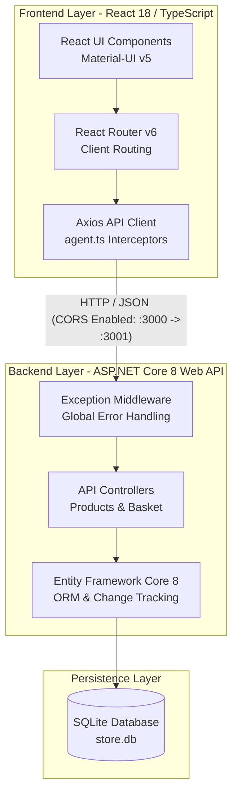

# Architecture Document: ReStore E-Commerce Application

## 1. Executive Summary & System Overview

**ReStore** is a full-stack e-commerce web application engineered with a clean client-server architecture. The platform features an ASP.NET Core 8 Web API backend (`API/`) providing robust RESTful endpoints, Entity Framework Core 8 persistence via SQLite (`store.db`), global exception handling middleware, and an interactive Swagger documentation portal. The frontend client (`client/`) is built with React 18, TypeScript, Material-UI (MUI 5), React Router 6, and Axios for client-server communication.

### Key Architectural Characteristics
- **Monorepo Structure:** Houses both backend (`API/`) and frontend (`client/`) in a single repository with separate build lifecycles (`RestoreApp.sln` for .NET, `npm` for React).
- **Session Tracking:** Stateless REST API utilizing an encrypted, essential cookie (`buyerId`) with a 30-day expiration to track guest/anonymous shopping baskets.
- **Resilient Error Management:** Custom global exception middleware (`ExceptionMiddleware`) capturing unhandled errors, logging them, and standardizing error responses into Problem Details JSON objects.
- **Type Safety:** Strong end-to-end data typing through C# DTOs/Entities on the backend and corresponding TypeScript interfaces on the client.

---

## 2. System Architecture Diagram

---

## 3. Services & Component Inventory Table

The table below details every service, controller, middleware, and core module comprising the ReStore application, along with its specific responsibility and underlying technology stack.

| Component Name | Path / Location | Component Type | Responsibility & Business Logic | Technology Stack |
| :--- | :--- | :--- | :--- | :--- |
| **API Project** | `API/` | Backend Service | Core backend service hosting REST endpoints, dependency injection container, database context configuration, and startup middleware pipeline. | ASP.NET Core 8, C#, .NET SDK 8 |
| **Products Controller** | `API/Controllers/ProductsController.cs` | API Controller | Exposes endpoints to retrieve the complete product catalog (`GET /api/products`) and detailed information for a single product (`GET /api/products/{id}`). | ASP.NET Core MVC, EF Core LINQ |
| **Basket Controller** | `API/Controllers/BasketController.cs` | API Controller | Manages customer shopping cart state, retrieving basket items via `buyerId` cookie (`GET /api/basket`) and adding items (`POST /api/basket`) with automatic cookie provisioning. | ASP.NET Core MVC, Cookie Management |
| **Buggy Controller** | `API/Controllers/BuggyController.cs` | API Controller | Provides dedicated test endpoints (`/api/buggy/*`) to simulate and validate 400 Bad Request, 401 Unauthorized, 404 Not Found, 400 Validation Error, and 500 Server Error responses. | ASP.NET Core Web API |
| **Exception Middleware** | `API/Middleware/ExceptionMiddleware.cs` | Custom Middleware | Global exception interception wrapping the HTTP pipeline; logs exceptions, returns RFC 7807 Problem Details JSON, and exposes stack traces exclusively in Development. | ASP.NET Core Middleware, System.Text.Json |
| **Store Context** | `API/Data/StoreContext.cs` | Database Context | Defines the Entity Framework Core persistence session, managing `DbSet<Product>` and `DbSet<Basket>` mappings to the database. | Entity Framework Core 8, C# |
| **Database Initializer** | `API/Data/DbInitializer.cs` | Seed Service | Seeds initial product catalog and mock data into the SQLite database upon application startup and migration execution. | EF Core, C# |
| **Product Entity** | `API/Entities/Product.cs` | Domain Entity | Represents catalog items with attributes including ID, Name, Description, Price (in cents), PictureUrl, Type, Brand, and Stock Quantity. | C#, EF Core Data Annotations |
| **Basket Entity** | `API/Entities/Basket.cs` | Domain Entity | Aggregate root for shopping carts containing Buyer ID and item collection, implementing domain methods `AddItem` and `RemoveItem`. | C# Domain Model |
| **Basket Item Entity** | `API/Entities/BasketItem.cs` | Domain Entity | Join entity mapping products to carts with quantity tracking, configured with cascade delete behavior. | C# Entity Model |
| **Basket DTOs** | `API/DTOs/BasketDto.cs`, `API/DTOs/BasketItemDto.cs` | Data Transfer Objects | Flattens and structures basket and product relational data for safe serialization to API clients. | C# DTOs |
| **React Client App** | `client/` | Frontend Service | Single-page application rendering the user interface, managing client state, routing, and HTTP communication with the backend. | React 18, TypeScript, Create React App |
| **API Client (`agent.ts`)** | `client/src/app/api/agent.ts` | Client Service | Centralized Axios HTTP client configuring base URL (`http://localhost:3001/api/`), artificial latency, and global response/error interceptors (toasts and error redirection). | Axios, TypeScript |
| **Router Configuration** | `client/src/app/router/Routes.tsx` | Client Routing | Defines client-side navigation paths for Home, Catalog, Product Details, About, Contact, and Error fallback pages. | React Router DOM v6 |
| **Catalog Feature** | `client/src/features/catalog/` | Frontend Module | Displays the product grid (`Catalog`, `ProductList`, `ProductCard`) and detailed product inspection view (`ProductDetails`). | React, Material-UI v5 |
| **About / Error Testing Page** | `client/src/features/about/AboutPage.tsx` | Frontend Feature | Informational page incorporating interactive test buttons to trigger and verify backend error handling and model-state validation display. | React, Material-UI v5 |

---

## 4. Deep-Dive: Key Subsystems & Data Flow

### 4.1 Request Pipeline & Error Handling
1. **Incoming Request:** HTTP requests arrive at the ASP.NET Core pipeline (`API/Program.cs`).
2. **Exception Interception:** `ExceptionMiddleware` sits at the very beginning of the middleware stack, wrapping all downstream execution.
3. **Routing & Controllers:** Requests pass through CORS policies and are routed to controllers (`ProductsController`, `BasketController`, `BuggyController`).
4. **Data Access:** Controllers execute queries via `StoreContext` against the underlying **SQLite database (`store.db`)**.
5. **Error Recovery:** If an unhandled exception occurs anywhere downstream, `ExceptionMiddleware` catches it, logs the exception details, and serializes a structured `ProblemDetails` JSON payload.

### 4.2 Basket & Session Management
- **Anonymous Tracking:** When a user adds an item to the cart without being logged in, `BasketController` generates a unique GUID `buyerId`.
- **Cookie Persistence:** This `buyerId` is attached to the HTTP response as an essential cookie (`IsEssential = true`, 30-day expiration).
- **Subsequent Requests:** The browser automatically sends the `buyerId` cookie on subsequent requests. `BasketController` retrieves the matching `Basket` and its items (`BasketItem` → `Product`) using eager loading (`.Include().ThenInclude()`).

### 4.3 Frontend Communication (`agent.ts`)
- **Axios Interceptor:** Every client API request passes through response interceptors in `client/src/app/api/agent.ts`.
- **Error Handling:** 
  - Status `400` validation errors are caught, flattened from model state dictionaries, and thrown as string arrays.
  - Status `500` errors automatically trigger client-side redirection to the server error page (`/server-error`) with error details stored in navigation state.
- **Artificial Delay:** A 500ms artificial delay (`sleep()`) is injected during development to simulate network latency and test loading states (`LoadingComponent`).

---

## 5. Confidence Assessment & Assumptions

| Aspect | Status | Notes |
| :--- | :--- | :--- |
| **Backend Stack** | **High Confidence** | Confirmed via `API.csproj`, `Program.cs`, and `appsettings.Development.json` (.NET 8, EF Core 8, SQLite). |
| **Frontend Stack** | **High Confidence** | Confirmed via `client/package.json`, `agent.ts`, and component files (React 18, TypeScript, MUI 5, Axios). |
| **Database Provider** | **High Confidence** | SQLite (`store.db`) is the active database provider, overriding legacy README references to PostgreSQL. |
| **Authentication Status** | **High Confidence** | No JWT or ASP.NET Identity implementation exists in the current codebase; session management is exclusively cookie-based (`buyerId`). |

---

## 6. Document Citations & References

- [API Project File](https://github.com/local/repo/blob/main/API/API.csproj) (`API/API.csproj`)
- [Backend Program Entrypoint](https://github.com/local/repo/blob/main/API/Program.cs) (`API/Program.cs`)
- [Products Controller](https://github.com/local/repo/blob/main/API/Controllers/ProductsController.cs) (`API/Controllers/ProductsController.cs`)
- [Basket Controller](https://github.com/local/repo/blob/main/API/Controllers/BasketController.cs) (`API/Controllers/BasketController.cs`)
- [Buggy Controller](https://github.com/local/repo/blob/main/API/Controllers/BuggyController.cs) (`API/Controllers/BuggyController.cs`)
- [Exception Middleware](https://github.com/local/repo/blob/main/API/Middleware/ExceptionMiddleware.cs) (`API/Middleware/ExceptionMiddleware.cs`)
- [Store Context](https://github.com/local/repo/blob/main/API/Data/StoreContext.cs) (`API/Data/StoreContext.cs`)
- [Client API Agent](https://github.com/local/repo/blob/main/client/src/app/api/agent.ts) (`client/src/app/api/agent.ts`)
- [Client Package Manifest](https://github.com/local/repo/blob/main/client/package.json) (`client/package.json`)
- [Business Requirements Document](/docs/Business_Requirements_Document.md) (`docs/Business_Requirements_Document.md`)
